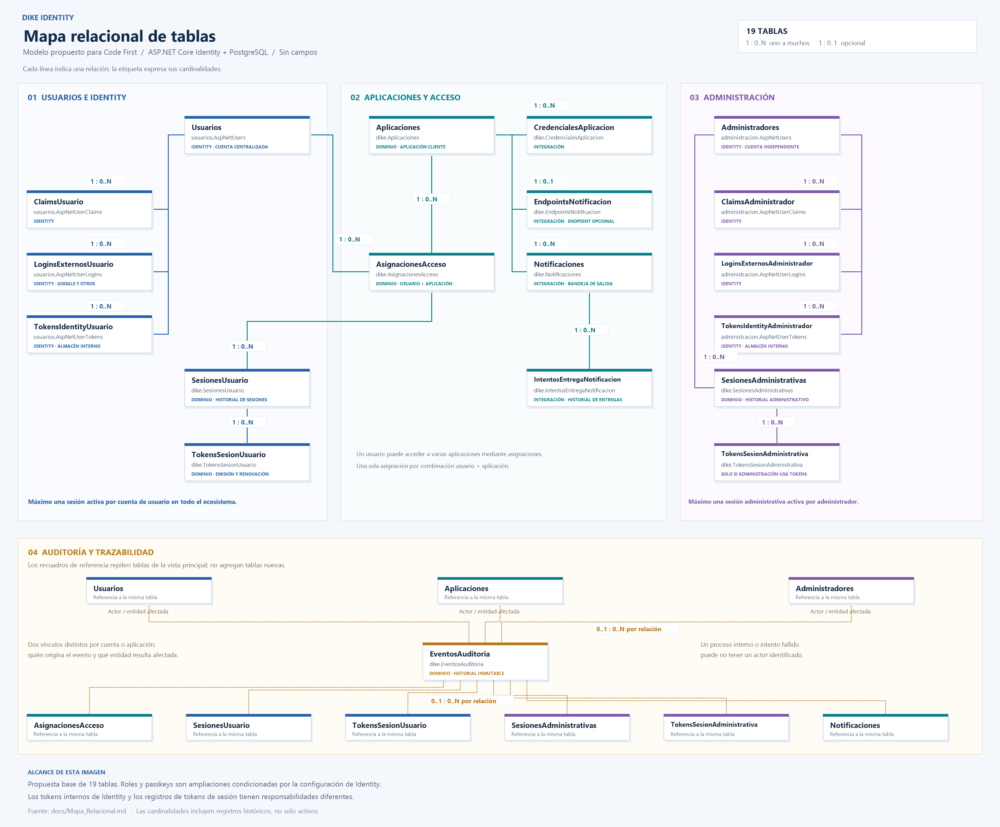
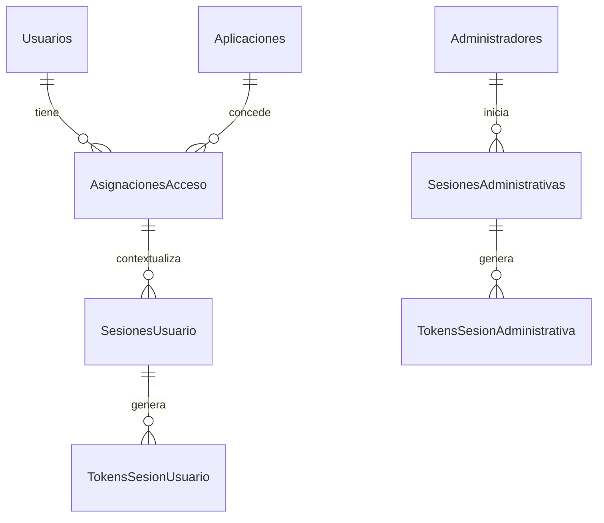
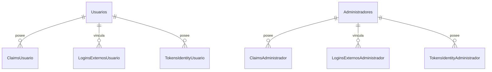
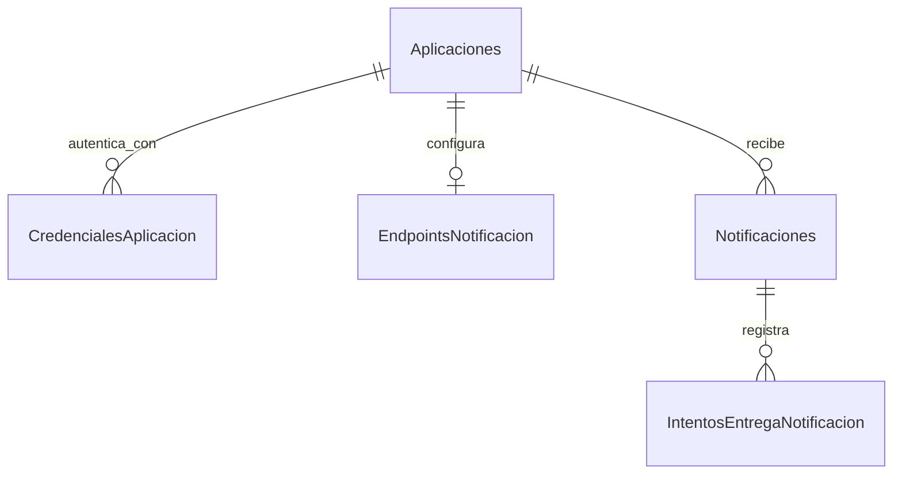
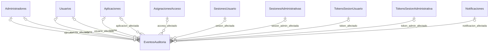
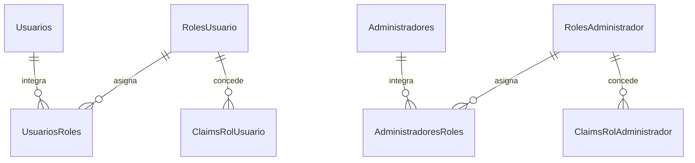
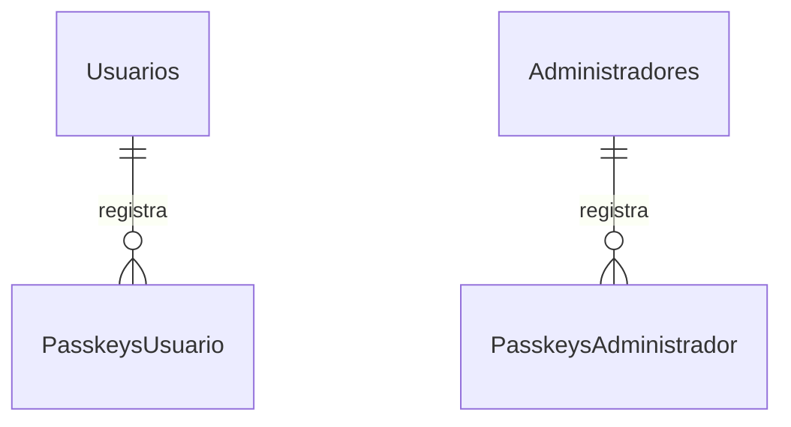

# Mapa relacional de Dike Identity

Propuesta de tablas y relaciones para el MVP con ASP.NET Core Identity, EF Core y PostgreSQL. No define campos, tipos de datos ni clases; sirve como base para el modelado Code First.

## Vista gráfica

[Abrir imagen PNG](Mapa_Relacional.png) · [Abrir SVG ampliable](Mapa_Relacional.svg)

La imagen representa la propuesta base. El bloque de auditoría repite referencias a las mismas tablas para mantener legibles sus conexiones. Las ampliaciones opcionales de roles y passkeys se describen más adelante.

La imagen y el SVG se pueden regenerar con el script [Generar-MapaRelacional.ps1](diagramas/Generar-MapaRelacional.ps1).

## Base documental y decisiones

- [Análisis del dominio](../Analisis_Dominio.md): relaciones de la sección 04 y reglas RN-01 a RN-17.
- [Definición funcional](../Definicion_Funcional.md): alcance del MVP y decisiones de integración DA-01 y DA-02.
- [Requerimientos](../Requerimientos.md): RF-01 a RF-11 y RNF-05/RNF-06. Los códigos RF utilizados en este mapa corresponden a este documento.

Se propone separar físicamente las cuentas de usuario y las cuentas administrativas mediante dos conjuntos de tablas de Identity, en los esquemas PostgreSQL `usuarios` y `administracion`. Las tablas propias del dominio se agrupan en `dike`. Esta es una decisión de diseño propuesta para cumplir la independencia exigida por RF-09; los documentos no obligan a usar dos esquemas ni dos almacenes de Identity.

Cada conjunto de Identity tendrá su propio tipo de cuenta, almacén y contexto de persistencia. Las credenciales, estados y sesiones serán independientes. No se propone una relación obligatoria entre ambas cuentas, aunque pertenezcan a una misma persona; la vinculación personal sigue pendiente en PD-18. Los esquemas pertenecen a la misma base de datos, por lo que las relaciones de dominio podrán mantener integridad referencial entre ellos.

Para el MVP se propone Identity sin roles. Las tablas de roles se muestran aparte como alternativa si se utiliza `IdentityDbContext` con soporte de roles. El acceso a una aplicación se representa mediante una asignación explícita.

**Diferencia documental:** la regla 8 de RF-01 en `Definicion_Funcional.md` permite que un token emitido siga funcionando hasta expirar tras desactivar un usuario. Este mapa adopta la invalidación inmediata definida en RN-10 del análisis de dominio y RF-01/RF-06/RF-07 de `Requerimientos.md`, que coinciden entre sí. La diferencia queda pendiente de unificar en los documentos originales.

## Lectura de los diagramas

Los nombres de los nodos son las tablas de la propuesta. Los diagramas dividen el mismo modelo por responsabilidad; una tabla repetida representa la misma tabla física.

| Notación | Significado |
|---|---|
| `||` | Exactamente uno. |
| `o|` | Cero o uno. |
| `o{` | Cero o muchos. |
| `|{` | Uno o muchos. |

Las relaciones muestran cardinalidades históricas, no cuántos registros están activos. Las restricciones de actividad se describen después de los diagramas.

## 1. Identidades, acceso, sesiones y tokens

| Tabla | Ubicación física propuesta | Responsabilidad | Requerimientos |
|---|---|---|---|
| Usuarios | `usuarios.AspNetUsers` | Cuenta centralizada de usuario; admite extender Identity con la información del perfil. | RF-01, RF-04, RF-08 |
| Administradores | `administracion.AspNetUsers` | Cuenta administrativa con autenticación y ciclo de vida propios. | RF-09 |
| Aplicaciones | `dike.Aplicaciones` | Aplicaciones clientes registradas y su configuración general. | RF-02 |
| AsignacionesAcceso | `dike.AsignacionesAcceso` | Tabla asociativa entre usuario y aplicación; conserva la relación aunque se desactive. | RF-03 |
| SesionesUsuario | `dike.SesionesUsuario` | Historial de autenticaciones de usuario dentro de una asignación de acceso. | RF-05, RF-06 |
| TokensSesionUsuario | `dike.TokensSesionUsuario` | Registros de emisiones, renovaciones e invalidaciones asociados a sesiones de usuario. | RF-07 |
| SesionesAdministrativas | `dike.SesionesAdministrativas` | Historial de sesiones de las cuentas administrativas. | RF-06, RF-09 |
| TokensSesionAdministrativa | `dike.TokensSesionAdministrativa` | Registros de tokens y renovación administrativos, si se adopta autenticación administrativa mediante tokens. | RF-06, RF-09; decisión técnica propuesta |

Usuarios y Aplicaciones tienen una relación muchos a muchos resuelta por AsignacionesAcceso. Cada asignación pertenece a un único usuario y a una única aplicación. Cada sesión de usuario pertenece a una asignación y obtiene de ella su usuario y aplicación; no requiere repetir esas relaciones directamente.

Cada sesión administrativa pertenece a un administrador y no depende de una aplicación ni de una asignación. Se propone separar también sus registros de tokens para mantener la independencia. Si la administración se autentica mediante cookies y no utiliza tokens de acceso/renovación, se puede omitir TokensSesionAdministrativa conservando SesionesAdministrativas.

Las tablas TokensSesionUsuario y TokensSesionAdministrativa representan el seguimiento de credenciales del ciclo de sesión. La persistencia concreta de tokens de acceso y credenciales de renovación dependerá de la estrategia elegida en PD-07, PD-08 y PD-09. No implican almacenar tokens completos en texto plano. Una sesión puede existir antes de registrar su primera emisión; una autenticación completada debe emitir las credenciales correspondientes.

## 2. Tablas proporcionadas por Identity

| Tabla del diagrama | Tabla física propuesta | Función |
|---|---|---|
| ClaimsUsuario | `usuarios.AspNetUserClaims` | Claims persistidos de la cuenta de usuario. |
| LoginsExternosUsuario | `usuarios.AspNetUserLogins` | Vinculaciones con proveedores externos, como Google. |
| TokensIdentityUsuario | `usuarios.AspNetUserTokens` | Almacenamiento de tokens de autenticación gestionados por los servicios de Identity. |
| ClaimsAdministrador | `administracion.AspNetUserClaims` | Claims persistidos de la cuenta administrativa. |
| LoginsExternosAdministrador | `administracion.AspNetUserLogins` | Vinculaciones externas de la cuenta administrativa, si se habilitan. |
| TokensIdentityAdministrador | `administracion.AspNetUserTokens` | Almacenamiento de tokens de Identity de la cuenta administrativa. |

La contraseña local se gestiona con la cuenta de Identity. Los inicios de sesión externos se vinculan mediante sus tablas de logins. Por ello, no se propone una tabla adicional de CredencialesUsuario ni una tabla genérica de MecanismosAutenticacion que duplique esos almacenes. Los estados adicionales exigidos por RF-04 podrán modelarse extendiendo las entidades correspondientes.

TokensIdentityUsuario y TokensIdentityAdministrador pertenecen al modelo de Identity; no sustituyen automáticamente las tablas de sesiones ni implementan por sí solas el historial de rotación y revocación requerido por Dike.

El perfil se integra inicialmente en Usuarios mediante la extensión de Identity que prevé el proyecto. No se necesita una tabla PerfilUsuario separada salvo que posteriormente se decida darle un ciclo de vida propio.

Microsoft documenta las relaciones de estas entidades y la alternativa `IdentityUserContext` sin roles en [Personalización del modelo de Identity](https://learn.microsoft.com/en-us/aspnet/core/security/authentication/customize-identity-model?view=aspnetcore-10.0).

## 3. Integración y notificaciones

| Tabla | Ubicación física propuesta | Responsabilidad | Requerimientos |
|---|---|---|---|
| CredencialesAplicacion | `dike.CredencialesAplicacion` | Credenciales de integración independientes de las cuentas humanas; permite conservar credenciales reemplazadas o revocadas. | RF-02, RF-05 |
| EndpointsNotificacion | `dike.EndpointsNotificacion` | Configuración opcional del único endpoint de notificaciones de una aplicación. | RF-02, RF-11 |
| Notificaciones | `dike.Notificaciones` | Mensajes destinados a una aplicación y pendientes de entrega o ya procesados. | RF-11 |
| IntentosEntregaNotificacion | `dike.IntentosEntregaNotificacion` | Historial de intentos y resultados de entrega de una notificación. | RF-11 |

Se propone separar CredencialesAplicacion para permitir su administración y renovación sin modificar la identidad de la aplicación. El mecanismo concreto sigue pendiente en PD-03. Una aplicación puede registrarse antes de recibir credenciales, pero solo podrá consumir los servicios cuando disponga de una credencial válida.

Cada endpoint pertenece a una sola aplicación, y una aplicación tiene como máximo uno configurado. La tabla separada es una decisión de organización; esta relación también podría integrarse en Aplicaciones al definir los campos.

Las notificaciones pertenecen a la aplicación destinataria. No dependen de la existencia permanente de su configuración de endpoint, de modo que cambiar esa configuración no elimina los mensajes ni sus intentos históricos. Cada intento deberá conservar el destino utilizado al momento del envío, aunque la configuración cambie después.

Notificaciones puede actuar como bandeja de salida persistente: el cambio administrativo y la notificación se guardan en una misma operación transaccional; la entrega se procesa posteriormente. Una notificación aún no enviada puede tener cero intentos. La política ante una aplicación sin endpoint se debe concretar junto con PD-16.

## 4. Auditoría y conservación histórica

| Tabla | Ubicación física propuesta | Responsabilidad | Requerimientos |
|---|---|---|---|
| EventosAuditoria | `dike.EventosAuditoria` | Historial inmutable de operaciones administrativas, autenticaciones, cambios y acontecimientos automáticos. | RF-10, RNF-05, RNF-06 |

Las relaciones de auditoría son opcionales desde el evento: un intento fallido puede no corresponder a una cuenta existente y un proceso automático puede no tener un actor humano. Un evento puede referenciar varias entidades relacionadas, por ejemplo administrador responsable, usuario afectado y asignación modificada.

El administrador que ejecuta una operación y la cuenta administrativa afectada son relaciones distintas. Lo mismo se aplica al usuario actor y al usuario afectado, y a la aplicación de origen y la aplicación afectada. Los procesos internos se identifican en el propio acontecimiento; no se necesita una tabla de ProcesosInternos para este alcance.

Esta tabla debe conservar el detalle de cada modificación para reconstruir el historial de usuarios, aplicaciones y asignaciones, incluyendo quién la realizó y cuándo. Conservar únicamente el registro actual o la referencia a la entidad no satisface ese historial. No se proponen tablas de historial adicionales mientras la auditoría cubra esa necesidad.

Los eventos relacionados con credenciales o proveedores externos pueden vincularse con la cuenta o aplicación correspondiente y conservar el contexto del cambio, sin registrar secretos. Los resultados detallados de entrega se conservan en IntentosEntregaNotificacion.

## 5. Restricciones que acompañan al mapa

1. **Asignación única:** solo existe una AsignacionesAcceso por combinación de usuario y aplicación, incluso si está desactivada. Reactivar actualiza la misma relación.
2. **Sesión única de usuario:** como máximo una sesión activa por cuenta de usuario en todo el ecosistema, no una por aplicación. Iniciar una sesión en otra aplicación finaliza la anterior, según RN-12 y RF-05. La validación debe considerar al usuario a través de sus asignaciones.
3. **Sesión administrativa única:** como máximo una sesión administrativa activa por administrador, independiente de su posible cuenta de usuario.
4. **Integridad del contexto:** cada sesión de usuario corresponde a una sola asignación; sus tokens heredan ese contexto. Las sesiones administrativas no requieren asignaciones.
5. **Condiciones vigentes:** usuario, aplicación y asignación deben estar habilitados para autenticar, renovar y aceptar el acceso. Desactivar cualquiera invalida las sesiones y tokens afectados.
6. **Rotación:** cada renovación genera un nuevo registro de emisión; las credenciales reemplazadas dejan de ser aceptadas y se conserva su trazabilidad.
7. **Endpoint único:** una aplicación tiene cero o un endpoint de notificaciones, y cada notificación tiene una sola aplicación destinataria.
8. **Cuenta externa única:** una misma cuenta de un proveedor externo no puede vincularse a varios usuarios del mismo almacén de Identity. La vinculación de Google exige administrador autorizado y coincidencia del correo verificado con el registrado, según RF-04.
9. **Conservación:** las desactivaciones no eliminan cuentas, aplicaciones, asignaciones, sesiones ni su historial. No se deben configurar eliminaciones en cascada que destruyan esos registros.
10. **Auditoría:** los eventos se agregan y consultan; las operaciones administrativas habituales no pueden modificarlos ni eliminarlos.

Estas reglas requieren configuración e implementación explícitas en Code First y en los servicios. Las cardinalidades por sí solas no garantizan la unicidad de sesiones activas, el control de concurrencia, la inmutabilidad de auditoría ni la invalidación inmediata de tokens.

## 6. Tablas de Identity condicionadas por la configuración

### Roles

Si se utiliza `IdentityDbContext` con soporte de roles, se incorporan estas relaciones en cada almacén:

| Tablas del diagrama | Tablas físicas propuestas |
|---|---|
| RolesUsuario, UsuariosRoles, ClaimsRolUsuario | `usuarios.AspNetRoles`, `usuarios.AspNetUserRoles`, `usuarios.AspNetRoleClaims` |
| RolesAdministrador, AdministradoresRoles, ClaimsRolAdministrador | `administracion.AspNetRoles`, `administracion.AspNetUserRoles`, `administracion.AspNetRoleClaims` |

Son seis tablas adicionales si ambos almacenes habilitan roles. Su existencia como infraestructura no incorpora la administración de roles y permisos internos de las aplicaciones al alcance del MVP. Tampoco reemplazan AsignacionesAcceso.

### Passkeys en .NET 10

El proyecto utiliza .NET 10. Si se configura el esquema de Identity versión 3, se incorpora también la tabla de passkeys por almacén:

| Tabla del diagrama | Tabla física propuesta |
|---|---|
| PasskeysUsuario | `usuarios.AspNetUserPasskeys` |
| PasskeysAdministrador | `administracion.AspNetUserPasskeys` |

Son tablas técnicas condicionadas por la versión del esquema; no implican habilitar esa forma de autenticación en el MVP. La condición y relación se verifican en el [código oficial de IdentityUserContext para .NET 10](https://github.com/dotnet/aspnetcore/blob/v10.0.0/src/Identity/EntityFrameworkCore/src/IdentityUserContext.cs).

## 7. Inventario de la propuesta

| Grupo | Cantidad |
|---|---:|
| Identity de usuarios, sin roles ni passkeys | 4 |
| Identity administrativo, sin roles ni passkeys | 4 |
| Aplicaciones y asignaciones | 2 |
| Sesiones y registros de tokens de ambos contextos | 4 |
| Credenciales de aplicación, endpoints, notificaciones e intentos | 4 |
| Auditoría | 1 |
| **Total de la propuesta con tokens administrativos** | **19** |

Si la administración utiliza cookies, el total baja a 18 al omitir TokensSesionAdministrativa y sus relaciones. El uso de roles en ambos almacenes agrega seis tablas; el esquema de passkeys agrega otras dos. La tabla técnica de historial de migraciones de EF Core no se cuenta como tabla del dominio.

Antes de generar las migraciones se debe concretar la estrategia de tokens y revocación, la autenticación administrativa, el mecanismo de credenciales de aplicación y la versión del esquema de Identity. Este mapa permite discutir esas decisiones sin anticipar los campos que se agregarán al modelo.
